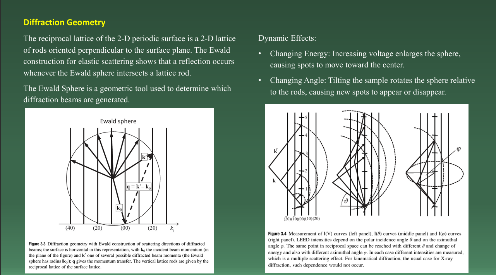
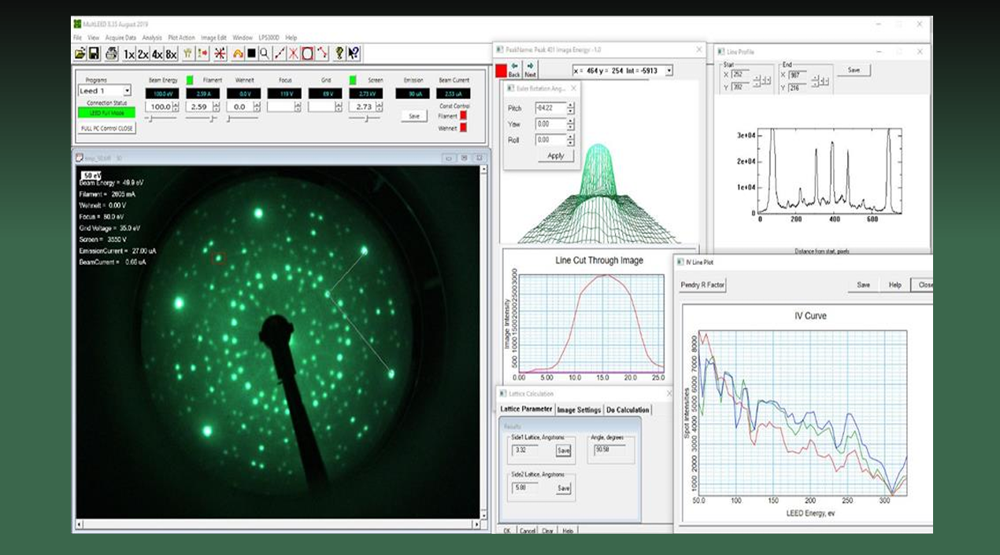
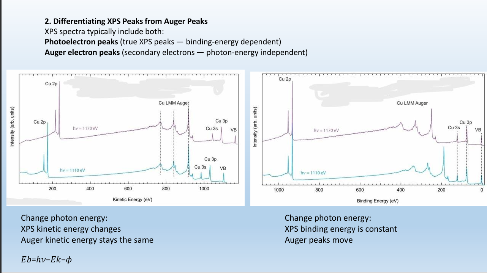
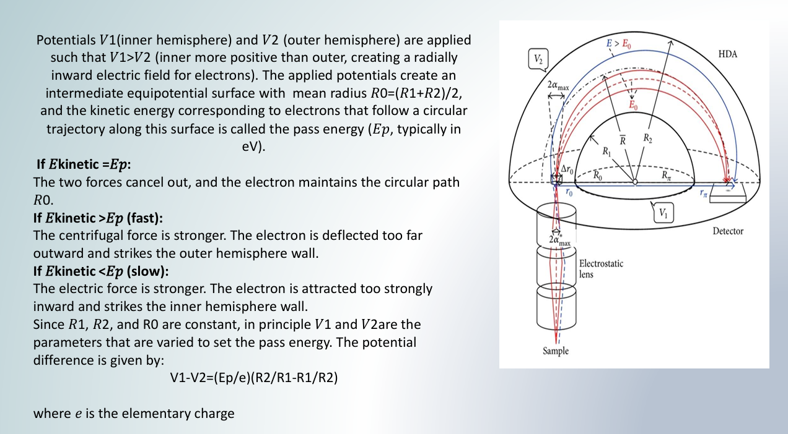

# Surface Analysis and Electron Spectroscopy

An academic project on surface characterization techniques, focusing on Low-Energy Electron Diffraction (LEED), X-ray Photoelectron Spectroscopy (XPS), Auger electron spectroscopy, and electron energy analysis.

## 1. Project Overview

Surface-sensitive analytical techniques play an important role in materials science by providing information about surface crystallography, elemental composition, and electronic structure. This project explores the fundamental principles of electron diffraction and electron spectroscopy, supported by scientific illustrations and examples of experimental data analysis.

The presentation emphasizes the physical mechanisms behind diffraction patterns, electron energy selection, and the interpretation of spectroscopic peaks.

## 2. Topics Covered

- **Low-Energy Electron Diffraction (LEED):** Diffraction geometry, reciprocal lattices, and Ewald sphere construction.
- **LEED Data Analysis:** Experimental diffraction patterns, intensity profiles, and intensity–voltage (I–V) curves.
- **X-ray Photoelectron Spectroscopy (XPS):** Photoelectron emission and binding-energy analysis.
- **Auger Electron Spectroscopy:** Auger electron emission and its distinction from photoelectron signals.
- **Hemispherical Electron Energy Analyzer:** Electrostatic fields, electron trajectories, and pass energy selection.

## 3. LEED Diffraction Geometry

LEED is a surface-sensitive technique used to investigate the periodic atomic arrangement of crystalline surfaces. The reciprocal lattice and Ewald sphere construction provide a geometrical framework for understanding the conditions under which diffracted electron beams are observed.

## 4. LEED Experimental Analysis

Experimental LEED patterns can be analyzed to investigate surface periodicity and diffraction intensity. Intensity–voltage curves describe how diffracted beam intensities change with incident electron energy and provide additional information for surface structure analysis.

## 5. Distinguishing XPS and Auger Peaks

XPS and Auger electron spectroscopy produce signals through different physical mechanisms. When the incident photon energy changes, XPS photoelectron peaks shift in kinetic energy while their binding energies remain constant. Auger peaks, under the same conditions, retain characteristic kinetic energies and consequently shift on a binding-energy scale.

## 6. Hemispherical Electron Energy Analyzer

A hemispherical electron energy analyzer separates electrons according to their kinetic energies using an electrostatic field between two hemispherical electrodes. The applied potentials determine the electron trajectories and the pass energy of electrons transmitted through the analyzer.

## 7. Learning Objectives

- Understand the principles of electron diffraction from crystalline surfaces.
- Interpret LEED diffraction patterns and intensity–voltage data.
- Explain the physical differences between XPS and Auger electron signals.
- Understand the role of electrostatic potentials in electron energy analysis.
- Connect theoretical concepts with experimental instrumentation and data interpretation.

## 8. Skills and Knowledge

- Materials characterization
- Surface science and crystallography
- Electron diffraction
- XPS and Auger spectroscopy
- Spectroscopic data interpretation
- Electron optics and energy analysis
- Scientific communication and technical presentation

## Project File

The complete presentation is available in **[XPS + LEED.pdf](XPS%20%2B%20LEED.pdf)**.

---

*Academic project in materials characterization and surface analysis.*
